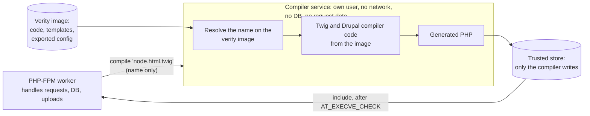

# Running PHP under a W^X policy

Status: design draft. Statements about PHP's own code are checked against this
tree and link to it; statements about frameworks are not, and say so.

## Goal

Make it practical to deploy PHP on a system that enforces write-xor-execute
(W^X): the kernel only lets code run if it comes from a trusted source, such as
a dm-verity image signed with a known key. systemd's `RestrictFileSystemAccess=`
BPF LSM is one implementation of such a policy.

The goal is to run the large majority of real PHP applications, in particular
Drupal, WordPress, Symfony and Laravel, not the whole language. Features that
cannot be squared with W^X (`eval()`, running shell commands) may be disabled.

This is not a fix for any particular vulnerability. It makes PHP a participant
in the system's trusted-execution policy, so that code an attacker writes to
disk or into memory cannot be run.

## Background

### What W^X requires of the kernel and of PHP

The kernel can refuse to execute native code, through `execve()` or an
executable `mmap()`, that does not come from a trusted file. It cannot see what
an interpreter does with the files it reads. For that, Linux 6.14 added a
contract between the kernel and interpreters:

- `execveat(fd, "", ..., AT_EMPTY_PATH | AT_EXECVE_CHECK)` asks the kernel
  whether a file may be executed, without executing it. It applies the same
  checks as `execve()`: a regular file, not on a `noexec` mount, with an execute
  bit for the caller, not open for writing, and the LSM's verdict.
- `SECBIT_EXEC_RESTRICT_FILE`: the interpreter must only interpret a file if
  `AT_EXECVE_CHECK` succeeds on it.
- `SECBIT_EXEC_DENY_INTERACTIVE`: the interpreter must never interpret code that
  did not come from such a file (`php -r`, `eval()`, interactive input).

The kernel does not enforce the securebits; the interpreter does.

### Opcache output is data

Opcache stores opcodes, which PHP's interpreter reads as data. They never need
executable memory: opcache's shared memory is mapped read-write, without
`PROT_EXEC`, on Linux ([shared_alloc_mmap.c:183](../ext/opcache/shared_alloc_mmap.c#L183)).
In this tree, only three things make writable memory executable:

- **The opcache JIT.** On Linux it takes its buffer from opcache's shared memory
  and switches it between writable and executable with `mprotect()`
  ([zend_jit.c:3566](../ext/opcache/jit/zend_jit.c#L3566),
  [zend_jit.c:3593](../ext/opcache/jit/zend_jit.c#L3593)). In ZTS builds the
  buffer is writable and executable at the same time. The JIT defaults to
  `opcache.jit=disable` ([zend_accelerator_module.c:349](../ext/opcache/zend_accelerator_module.c#L349)),
  which turns it off entirely ([zend_jit.c:3684](../ext/opcache/jit/zend_jit.c#L3684)).
- **PCRE's JIT** (sljit, under `ext/pcre/pcre2lib/sljit/`), controlled by
  `pcre.jit`, which defaults to on ([php_pcre.c:351](../ext/pcre/php_pcre.c#L351)).
- **`opcache.huge_code_pages`**, which copies PHP's own code into anonymous
  memory that is writable and executable while it is set up
  ([ZendAccelerator.c:3267](../ext/opcache/ZendAccelerator.c#L3267)). It
  defaults to off ([zend_accelerator_module.c:339](../ext/opcache/zend_accelerator_module.c#L339)).

With those three off, stock PHP already satisfies a kernel W^X policy for its
own memory; with the defaults in this tree, only `pcre.jit` needs changing.
What PHP does not yet do is take part in the policy for the PHP code it runs.

That opcodes are data matters only to the CPU. For deciding what PHP may load,
this design treats them as executable code. An opcode array decides what the
process does just as machine code would: it can call any function PHP has,
`system()` included. So a cache file gets the same trust decision as a native
binary or a PHP source file. PHP loads it only if the kernel says it may be
executed: it has the execute bit, is not on a `noexec` mount, is not open for
writing, and passes the LSM's policy. In practice, that means it is marked
executable and lives on the verity image. The cache stays out of executable
memory; only the decision about loading it is the one the kernel makes for code.
Section 1 describes how PHP asks.

## Design

### 1. PHP asks the kernel before compiling or loading code

PHP runs `AT_EXECVE_CHECK` on the file descriptor of every file it is about to
compile, and on every opcache file-cache entry it is about to load:

- **Source files**, when `SECBIT_EXEC_RESTRICT_FILE` is set or an ini setting
  asks for it. Scripts are opened in three places:
  - the CLI opens its script with `fopen()` ([php_cli.c:558](../sapi/cli/php_cli.c#L558));
  - FPM and CGI go through `php_fopen_primary_script()` ([fopen_wrappers.c:365](../main/fopen_wrappers.c#L365));
  - `include` and `require` open a PHP stream ([main.c:1665](../main/main.c#L1665)).

  All three meet in `zend_stream_fixup()` ([zend_stream.c:126](../Zend/zend_stream.c#L126)),
  called from `open_file_for_scanning()` ([zend_language_scanner.l:529](../Zend/zend_language_scanner.l#L529))
  before every file is compiled. That is the one place to check. The Zend layer
  cannot see a PHP stream's descriptor, so `main/` needs to provide it through a
  hook, as it already provides `zend_stream_open_function`. A handle with no
  descriptor (`data://`, `php://memory`) cannot pass the check, which covers
  stream includes. Stdin, which the CLI reads as a `FILE *`, passes only if
  descriptor 0 itself passes, as the kernel's documentation asks.
- **Opcache file-cache entries.** `zend_file_cache_script_load_ex()` opens the
  cache file ([zend_file_cache.c:1937](../ext/opcache/zend_file_cache.c#L1937)),
  reads it into memory and rewrites the pointers inside. Opcache does not use a
  cache file in place, so the check has to be on the descriptor opened there.
  The cache file is the compiled form of the code, so it gets the same trust
  decision as the source. Today, the only integrity checks are the PHP build ID
  ([zend_file_cache.c:1971](../ext/opcache/zend_file_cache.c#L1971)) and an
  Adler-32 checksum ([zend_file_cache.c:2033](../ext/opcache/zend_file_cache.c#L2033)),
  which detect accidents, not tampering.

The check runs on the same descriptor PHP then reads from, so the file cannot be
swapped between the check and the read.

A script that opcache finds in shared memory by its lookup key is used without
opening the file again ([ZendAccelerator.c:2291](../ext/opcache/ZendAccelerator.c#L2291)),
so it is checked once, when first compiled or loaded. That is sound only while
the files cannot change, which the verity image guarantees.

Using `AT_EXECVE_CHECK` instead of mapping the data `PROT_EXEC` to see whether
the LSM allows it:

- does not make data executable to the CPU, so it gives an attacker no new
  executable bytes to jump into;
- is the documented contract for this exact question, so reviewers and other
  interpreters can see what PHP is doing.

In practice, "trusted" means "executable": the build marks cache files and
scripts executable and puts them on the verity image. A file the policy does not
trust fails the check. What PHP does then depends on the mode (section 4): in
audit mode it logs the failure and loads the file anyway; in enforce mode it
refuses.

On kernels older than 6.14, enforce mode refuses to start. Audit mode logs once
that it cannot check and carries on.

### 2. PHP refuses code that does not come from a checked file

When `SECBIT_EXEC_DENY_INTERACTIVE` is set, or an ini setting asks for it, PHP
refuses:

- `eval()`;
- `php -r` and code read from stdin, unless stdin itself passes the check;
- `include` and `require` of anything that is not a plain file: `data://`,
  `php://`, `phar://`, and URL wrappers.

`eval()` is part of the language (an opcode, not a function), so
`disable_functions` cannot turn it off; this needs to be a new check in the
engine. Every way of compiling code from a string goes through
`zend_compile_string()`:

- `eval()` ([zend_execute.c:5417](../Zend/zend_execute.c#L5417));
- `zend_eval_stringl()` ([zend_execute_API.c:1427](../Zend/zend_execute_API.c#L1427)),
  which the CLI uses for `-r`, `-B`, `-R` and `-E`
  ([php_cli.c:971](../sapi/cli/php_cli.c#L971)) and extensions can call;
- phpdbg's prompt and conditional breakpoints.

Refusing in `zend_compile_string()` covers all of them at once.

Stream includes are covered by the descriptor check in section 1. Opcache sends
any stream other than `file://` and `phar://` straight to the normal compiler
([ZendAccelerator.c:205](../ext/opcache/ZendAccelerator.c#L205),
[ZendAccelerator.c:2292](../ext/opcache/ZendAccelerator.c#L2292)), so the check
has to sit in the normal compile path, not only in opcache.

### 3. Running other programs

These functions all run `/bin/sh -c` through the C library's `popen()`:

- `exec()`, `system()` and `passthru()` ([exec.c:123](../ext/standard/exec.c#L123));
- `shell_exec()` and backticks ([exec.c:514](../ext/standard/exec.c#L514));
- `popen()` ([file.c:843](../ext/standard/file.c#L843)).

On a system without a shell they already fail. `exec_policy.processes`
(section 4) turns them off cleanly instead. Points to watch:

- `mail()` runs sendmail through `popen()` ([mail.c:574](../ext/standard/mail.c#L574)),
  and WordPress's `wp_mail` uses it by default. WordPress sites need SMTP
  instead.
- `proc_open()` with a command string runs `/bin/sh -c`; with an array of
  arguments it runs the program directly, without a shell
  ([proc_open.c:1417](../ext/standard/proc_open.c#L1417),
  [proc_open.c:1447](../ext/standard/proc_open.c#L1447)). The array form is
  compatible with W^X as long as the program it runs is on the image.
- `pcntl_exec()` calls `execve()` directly ([pcntl.c:763](../ext/pcntl/pcntl.c#L763))
  and should be covered by the same setting.

### 4. Audit and enforce modes

A site turning this on needs to find out what would break before anything does.
Each control therefore has three modes:

- **`off`**: today's behaviour. Nothing is checked or logged.
- **`audit`**: PHP runs every check and logs what would have been refused, but
  carries on as if the check had passed. Nothing changes for the site's users.
- **`enforce`**: PHP refuses what fails the check.

The controls are set separately, because sites will fix them at different
speeds. A site might enforce the `eval()` refusal on day one while it is still
auditing file checks and moving its mail to SMTP. Proposed ini settings, all
`PHP_INI_SYSTEM` so that a script cannot change them:

| Setting | Controls | Section |
|---|---|---|
| `exec_policy.files` | `AT_EXECVE_CHECK` on scripts and opcache cache files | 1 |
| `exec_policy.strings` | `eval()`, `-r`, stdin and other code compiled from strings | 2 |
| `exec_policy.processes` | The shell and exec functions, `mail()` and `pcntl_exec()` | 3 |
| `opcache.file_cache_strict` | A cache miss compiles source (audit) or fails (enforce) | 5 |

The names are placeholders for the RFC.

**The kernel's securebits override the ini settings.** If
`SECBIT_EXEC_RESTRICT_FILE` is set, PHP enforces `exec_policy.files`; if
`SECBIT_EXEC_DENY_INTERACTIVE` is set, it enforces `exec_policy.strings`;
whatever the ini says. The kernel's contract requires it, and an ini file must
not be able to weaken a policy the system imposed. The other two controls have
no securebit and follow the ini alone. Audit mode is for sites trying the
hardening on their own, before the system sets the securebits. PHP reports the
mode actually in force, and why, in `phpinfo()` and `php -i`.

**What audit mode logs.** One structured record per would-be refusal:

- the control and the mode;
- what was refused: the file's path and the check's `errno`, the first line of
  the string being compiled, or the command being run;
- where it came from: the PHP file and line that made the call, and for web
  requests the request URI;
- the process ID and SAPI.

The records go to PHP's error log at a fixed level, and to the journal when PHP
runs under systemd. They must not go to the page (`display_errors`), and
neither `@` nor a user error handler may suppress them; otherwise an
application could hide its own violations. Each distinct (control, path or call
site) is logged once per worker process, so a busy site does not flood its logs.
Opcache's status (`opcache_get_status()`) also counts audit events, so a site
can watch the number fall to zero before switching to enforce.

**What enforce mode does.** Each refusal is a clear, catchable `Error` naming
the policy, not a missing-file warning or a generic failure, so frameworks show
it and logs explain it:

- `include` of a file that fails the check: `Error`, also for `include`, where a
  missing file would only warn. Silently skipping code is worse than stopping.
- `eval()` and other string compilation: `Error`.
- An exec function: the functions are removed, as `disable_functions` removes
  them, so calling one is the usual undefined-function `Error`. Libraries often
  check `function_exists('proc_open')` or `is_callable('exec')` and fall back to
  something else; removing the functions lets that fallback work. In audit mode
  the functions stay and each call is logged, so the log shows what enforce mode
  will take away.
- A miss under `opcache.file_cache_strict`: `Error`, as for a file that fails
  the check.

Enforce mode logs the same records as audit mode.

**The rollout this enables:**

1. Deploy with every control in `audit`, in staging and then in production.
2. Read the log: each record names the file, call site or command to fix
   (warm a framework cache at build time, switch mail to SMTP, pass
   `proc_open()` an array).
3. Switch each control to `enforce` once its count stays at zero.
4. Let the system set the securebits, which locks in enforcement.

### 5. A hardened configuration profile

No code changes. These settings make stock PHP compatible with a kernel W^X
policy for its own memory. The first two are already the defaults in this tree;
setting them explicitly guards against a distribution's `php.ini` changing them.

```ini
opcache.jit=disable
opcache.huge_code_pages=0
pcre.jit=0
```

and, for a precompiled cache shipped on the image:

```ini
opcache.file_cache=/path/on/the/verity/image
opcache.file_cache_only=1
opcache.file_cache_read_only=1
opcache.validate_timestamps=0
```

`opcache.file_cache_only` already turns the JIT off
([ZendAccelerator.c:3599](../ext/opcache/ZendAccelerator.c#L3599)). An opcache
file cache only loads in the exact PHP build that wrote it
([zend_file_cache.c:1971](../ext/opcache/zend_file_cache.c#L1971)), so the cache
must be built with the same binary that runs it. That suits images.

What this configuration does not do, and `opcache.file_cache_strict`
(section 4) has to add:

- **The source file must still exist.** Opcache opens it on every load to
  resolve its real path, and finds the cache file from that path
  ([ZendAccelerator.c:1936](../ext/opcache/ZendAccelerator.c#L1936),
  [zend_file_cache.c:1935](../ext/opcache/zend_file_cache.c#L1935)). The image
  ships both the source and the cache.
- **A cache miss compiles the source**
  ([ZendAccelerator.c:1989](../ext/opcache/ZendAccelerator.c#L1989)).
  `file_cache_read_only` only stops the result being written back.
  `opcache.file_cache_strict` logs the miss there in audit mode and refuses it
  in enforce mode.

## Code that frameworks generate at runtime

The largest obstacle is not PHP but frameworks that write PHP files while they
run and then include them. A W^X policy refuses to run those files.

| Stack | Generated at runtime | Build-time replacement |
|---|---|---|
| Symfony | DI container and routing in `var/cache/` | `cache:warmup` |
| Laravel | Blade views in `storage/framework/views`; `bootstrap/cache/*.php` | `config:cache`, `route:cache`, `view:cache` |
| Drupal | Twig templates through PhpStorage, under `sites/default/files/php` | No complete warmup; `drush twig:compile` covers templates shipped as files |
| Twig with no cache directory | `eval()` of the compiled template | Configure a cache directory and warm it |
| WordPress | Plugin, theme and update installs from the admin pages | `DISALLOW_FILE_MODS` |

Drupal's service container is serialized data in the cache tables, not
generated PHP, so it is not affected. Twig is Drupal's main source of generated
code.

The details in this section come from the frameworks' documentation and
behaviour, not from this repository, and need confirming against real installs.

### Precompiling at build time

The simplest approach compiles everything when the image is built:

1. `composer install`.
2. For Drupal: install the site from its exported configuration into a
   throwaway database, then run `drush twig:compile`. For the other frameworks,
   run their warmup commands.
3. Optionally, run opcache over every PHP file to produce the file cache.
4. Put the code, the generated PHP and the cache on the verity image, marked
   executable.

This should be prototyped first, because it shows how many templates are left
uncompiled at runtime.

### Hermetic lazy compilation

For what the build cannot predict, a separate compiler service compiles on
demand. It is hermetic: its inputs are only the image, never the database,
uploads or anything from a request.



- **The compiler takes a template's name, never its text.** A compromised worker
  can ask for a compile but cannot choose what gets compiled. The compiler
  resolves the name itself, on the image.
- **Its inputs are the image only:** template files, the Twig and Drupal
  compiler code, and the exported configuration that decides which Twig
  extensions and node visitors are active (for Drupal, `core.extension.yml` and
  the like). The same inputs always give the same output.
- **Worker side, for Drupal:** a PhpStorage class, selected through
  `$settings['php_storage']`, that on a miss discards the PHP the worker
  compiled. It sends the compiler the template name and cache key, waits, and
  includes the result. The worker's own output can be compared with the
  compiler's as a canary: a difference means something is wrong.
- **Content-addressed output:** each generated file is named by a hash of
  (template source, compiler version, configuration profile). The next image
  build can collect what was compiled lazily in production and bake it in, so
  lazy compiles become rare over time.
- **Isolation:** a systemd unit with its own user, `PrivateNetwork=`,
  `ProtectSystem=strict`, write access only to the store, and a varlink socket
  that workers call.

#### How the kernel trusts the store

Files in the store are not on the verity image, so the policy needs another
reason to trust them. Options:

1. **fs-verity with signatures.** The compiler signs what it writes, and the
   policy allows signed files (IPE can already do this). The signing key lives
   in the compiler service.
2. **A store only the compiler can write.** The policy trusts files on that
   mount because only the compiler's user can write there. Simpler; trust rests
   on write access instead of cryptography.
3. **No runtime trust.** Lazy compiles only queue templates for the next build,
   and a miss fails until then. The most hermetic option, but not really lazy.

Whether `RestrictFileSystemAccess=` can express options 1 or 2 is an open
question for the kernel side.

#### What lazy compilation cannot cover

Drupal also compiles Twig text stored in configuration, for example the
"Rewrite results" text in a Views field. That is admin-entered data:

- if the configuration is exported and shipped with the image, it is an input
  to the hermetic build like any template file;
- if someone edits it in production, it is user-created data. It must be
  refused, or wait for the next build.

Read-only configuration in production, which many Drupal hosts already use,
makes this clean.

## Development workflow

Developers expect to save a file and reload the page. In development, no W^X
policy applies and PHP runs as it does today. On deployment, the image and its
caches are rebuilt and PHP-FPM reloads gracefully (SIGUSR2,
[php-fpm.8.in:169](../sapi/fpm/php-fpm.8.in#L169)). That is tooling
around PHP, not a change to it.

An out-of-process JIT, with a compiler handing sealed memory to the runtime,
is a separate and later project. The W^X policy described here denies
executable memfds, so it would need the kernel side to trust them first.
`F_SEAL_FUTURE_WRITE` does not revoke writable mappings that already exist, so
the compiler process would stay able to change the code after sealing it.

## Plan

1. **Hardened profile:** the configuration above, and a run of PHP's test suite
   under it.
2. **PHP patch:** `AT_EXECVE_CHECK` on scripts and opcache cache files, the
   securebits, and the `exec_policy.*` controls for files, strings and
   processes, each with audit and enforce modes and the audit log.
3. **Framework survey:** a stock install of Drupal, WordPress, Symfony and
   Laravel, each running from a read-only code directory under the profile,
   with build-time warmup and every control in audit mode. The audit log is the
   survey's result: what each framework would break.
4. **`opcache.file_cache_strict`:** opcache loads only checked cache files and
   never compiles source, with the same audit and enforce modes.
5. **Hermetic lazy compiler** for Drupal's Twig, once the kernel trust question
   is settled.
6. **Deployment tooling:** rebuild and reload on change.

## Open questions

- Which store-trust option `RestrictFileSystemAccess=` can support.
- How many Drupal templates `drush twig:compile` leaves uncompiled on a real
  site.
- Whether enforce mode should treat an untrusted cache file as a miss (compile
  from checked source) or a hard error.
- Whether audit records should also go to a dedicated file, separate from the
  error log, so that monitoring can watch them without parsing other errors.
