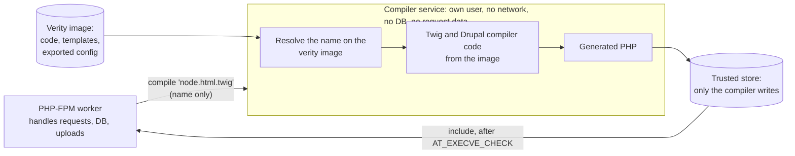

# Running PHP under a W^X policy

Status: design draft.

## Goal

Make it practical to deploy PHP on a system that enforces write-xor-execute
(W^X): the kernel only lets code run if it comes from a trusted source, such as
a dm-verity image signed with a known key. systemd's `RestrictFileSystemAccess=`
BPF LSM is one implementation of such a policy.

The goal is to run the large majority of real PHP applications, in particular
Drupal, WordPress, Symfony and Laravel, not the whole language. Features that
cannot be squared with W^X (`eval()`, running shell commands) may be disabled.

This is not a fix for any particular vulnerability. It makes PHP a participant
in the system's trusted-execution policy, so that code an attacker writes to
disk or into memory cannot be run.

## Background

### What W^X requires of the kernel and of PHP

The kernel can refuse to execute native code, through `execve()` or an
executable `mmap()`, that does not come from a trusted file. It cannot see what
an interpreter does with the files it reads. For that, Linux 6.14 added a
contract between the kernel and interpreters:

- `execveat(fd, "", ..., AT_EMPTY_PATH | AT_EXECVE_CHECK)` asks the kernel
  whether a file may be executed, without executing it. It applies the same
  checks as `execve()`: a regular file, not on a `noexec` mount, with an execute
  bit for the caller, not open for writing, and the LSM's verdict.
- `SECBIT_EXEC_RESTRICT_FILE`: the interpreter must only interpret a file if
  `AT_EXECVE_CHECK` succeeds on it.
- `SECBIT_EXEC_DENY_INTERACTIVE`: the interpreter must never interpret code that
  did not come from such a file (`php -r`, `eval()`, interactive input).

The kernel does not enforce the securebits; the interpreter does.

### Opcache output is data

Opcache stores opcodes, which PHP's interpreter reads as data. They never need
executable memory. In this tree, only three things make writable memory
executable:

- the opcache JIT ([zend_jit.c:3824](../ext/opcache/jit/zend_jit.c#L3824));
- PCRE's JIT (sljit, under `ext/pcre/pcre2lib/sljit/`), controlled by `pcre.jit`;
- `opcache.huge_code_pages`, which copies PHP's own code into anonymous
  executable memory ([ZendAccelerator.c:3267](../ext/opcache/ZendAccelerator.c#L3267)).

With those three off, stock PHP already satisfies a kernel W^X policy for its
own memory. What it does not yet do is take part in the policy for the PHP code
it runs.

## Design

### 1. PHP asks the kernel before compiling or loading code

PHP runs `AT_EXECVE_CHECK` on the file descriptor of every file it is about to
compile, and on every opcache file-cache entry it is about to load:

- **Source files**: where PHP opens a script in order to compile it, when
  `SECBIT_EXEC_RESTRICT_FILE` is set or an ini setting asks for it.
- **Opcache file-cache entries**: where opcache opens a cache file to load it.
  Opcache does not use a cache file in place. It reads it and rewrites the
  pointers inside ([zend_file_cache.c](../ext/opcache/zend_file_cache.c)), so the
  check has to be on the file itself. The cache file is the compiled form of
  the code, so it gets the same trust decision as the source.

The check runs on the same descriptor PHP then reads from, so the file cannot be
swapped between the check and the read.

Using `AT_EXECVE_CHECK` instead of mapping the data `PROT_EXEC` to see whether
the LSM allows it:

- does not make data executable to the CPU, so it gives an attacker no new
  executable bytes to jump into;
- is the documented contract for this exact question, so reviewers and other
  interpreters can see what PHP is doing.

In practice, "trusted" means "executable": the build marks cache files and
scripts executable and puts them on the verity image. A file the policy does not
trust fails the check. PHP then treats it as a cache miss, or as an error in
strict mode.

On kernels older than 6.14, the strict mode refuses to start. The non-strict
mode logs that it cannot check and carries on.

### 2. PHP refuses code that does not come from a checked file

When `SECBIT_EXEC_DENY_INTERACTIVE` is set, or an ini setting asks for it, PHP
refuses:

- `eval()`;
- `php -r` and code read from stdin, unless stdin itself passes the check;
- `include` and `require` of anything that is not a plain file: `data://`,
  `php://`, `phar://`, and URL wrappers.

`eval()` is part of the language, so `disable_functions` cannot turn it off;
this needs to be a new check in the engine.

### 3. Running other programs

`system()`, `exec()`, `shell_exec()`, backticks, `passthru()` and `popen()` all
run `/bin/sh -c`. On a system without a shell they already fail. An ini setting
turns them off with a clear error instead. Points to watch:

- `mail()` runs sendmail through `popen()`, and WordPress's `wp_mail` uses it by
  default. WordPress sites need SMTP instead.
- `proc_open()` with an array of arguments does not use a shell. It is
  compatible with W^X as long as the program it runs is on the image.
- `pcntl_exec()` also starts programs and should be covered by the same
  setting.

### 4. A hardened configuration profile

No code changes. These settings make stock PHP compatible with a kernel W^X
policy for its own memory:

```ini
opcache.jit=disable
opcache.huge_code_pages=0
pcre.jit=0
```

and, for a precompiled cache shipped on the image:

```ini
opcache.file_cache=/path/on/the/verity/image
opcache.file_cache_only=1
opcache.file_cache_read_only=1
opcache.validate_timestamps=0
```

`opcache.file_cache_only` already turns the JIT off
([ZendAccelerator.c:3599](../ext/opcache/ZendAccelerator.c#L3599)). An opcache
file cache only loads in the exact PHP build that wrote it, so the cache must be
built with the same binary that runs it. That suits images.

## Code that frameworks generate at runtime

The largest obstacle is not PHP but frameworks that write PHP files while they
run and then include them. A W^X policy refuses to run those files.

| Stack | Generated at runtime | Build-time replacement |
|---|---|---|
| Symfony | DI container and routing in `var/cache/` | `cache:warmup` |
| Laravel | Blade views in `storage/framework/views`; `bootstrap/cache/*.php` | `config:cache`, `route:cache`, `view:cache` |
| Drupal | Twig templates through PhpStorage, under `sites/default/files/php` | No complete warmup; `drush twig:compile` covers templates shipped as files |
| Twig with no cache directory | `eval()` of the compiled template | Configure a cache directory and warm it |
| WordPress | Plugin, theme and update installs from the admin pages | `DISALLOW_FILE_MODS` |

Drupal's service container is serialized data in the cache tables, not
generated PHP, so it is not affected. Twig is Drupal's main source of generated
code.

The details in this section come from the frameworks' documentation and
behaviour, not from this repository, and need confirming against real installs.

### Precompiling at build time

The simplest approach compiles everything when the image is built:

1. `composer install`.
2. For Drupal: install the site from its exported configuration into a
   throwaway database, then run `drush twig:compile`. For the other frameworks,
   run their warmup commands.
3. Optionally, run opcache over every PHP file to produce the file cache.
4. Put the code, the generated PHP and the cache on the verity image, marked
   executable.

This should be prototyped first, because it shows how many templates are left
uncompiled at runtime.

### Hermetic lazy compilation

For what the build cannot predict, a separate compiler service compiles on
demand. It is hermetic: its inputs are only the image, never the database,
uploads or anything from a request.



- **The compiler takes a template's name, never its text.** A compromised worker
  can ask for a compile but cannot choose what gets compiled. The compiler
  resolves the name itself, on the image.
- **Its inputs are the image only:** template files, the Twig and Drupal
  compiler code, and the exported configuration that decides which Twig
  extensions and node visitors are active (for Drupal, `core.extension.yml` and
  the like). The same inputs always give the same output.
- **Worker side, for Drupal:** a PhpStorage class, selected through
  `$settings['php_storage']`, that on a miss discards the PHP the worker
  compiled. It sends the compiler the template name and cache key, waits, and
  includes the result. The worker's own output can be compared with the
  compiler's as a canary: a difference means something is wrong.
- **Content-addressed output:** each generated file is named by a hash of
  (template source, compiler version, configuration profile). The next image
  build can collect what was compiled lazily in production and bake it in, so
  lazy compiles become rare over time.
- **Isolation:** a systemd unit with its own user, `PrivateNetwork=`,
  `ProtectSystem=strict`, write access only to the store, and a varlink socket
  that workers call.

#### How the kernel trusts the store

Files in the store are not on the verity image, so the policy needs another
reason to trust them. Options:

1. **fs-verity with signatures.** The compiler signs what it writes, and the
   policy allows signed files (IPE can already do this). The signing key lives
   in the compiler service.
2. **A store only the compiler can write.** The policy trusts files on that
   mount because only the compiler's user can write there. Simpler; trust rests
   on write access instead of cryptography.
3. **No runtime trust.** Lazy compiles only queue templates for the next build,
   and a miss fails until then. The most hermetic option, but not really lazy.

Whether `RestrictFileSystemAccess=` can express options 1 or 2 is an open
question for the kernel side.

#### What lazy compilation cannot cover

Drupal also compiles Twig text stored in configuration, for example the
"Rewrite results" text in a Views field. That is admin-entered data:

- if the configuration is exported and shipped with the image, it is an input
  to the hermetic build like any template file;
- if someone edits it in production, it is user-created data. It must be
  refused, or wait for the next build.

Read-only configuration in production, which many Drupal hosts already use,
makes this clean.

## Development workflow

Developers expect to save a file and reload the page. In development, no W^X
policy applies and PHP runs as it does today. On deployment, the image and its
caches are rebuilt and PHP-FPM reloads gracefully (SIGUSR2). That is tooling
around PHP, not a change to it.

An out-of-process JIT, with a compiler handing sealed memory to the runtime,
is a separate and later project. The W^X policy described here denies
executable memfds, so it would need the kernel side to trust them first.
`F_SEAL_FUTURE_WRITE` does not revoke writable mappings that already exist, so
the compiler process would stay able to change the code after sealing it.

## Plan

1. **Hardened profile:** the configuration above, and a run of PHP's test suite
   under it.
2. **PHP patch:** `AT_EXECVE_CHECK` on scripts and opcache cache files, the
   securebits, and ini settings that refuse `eval()` and running programs.
3. **Framework survey:** a stock install of Drupal, WordPress, Symfony and
   Laravel, each running from a read-only code directory under the profile and
   the patch, with build-time warmup. Record what breaks.
4. **Strict cache-only mode:** opcache loads only checked cache files and never
   compiles source.
5. **Hermetic lazy compiler** for Drupal's Twig, once the kernel trust question
   is settled.
6. **Deployment tooling:** rebuild and reload on change.

## Open questions

- Which store-trust option `RestrictFileSystemAccess=` can support.
- How many Drupal templates `drush twig:compile` leaves uncompiled on a real
  site.
- Whether strict mode should treat an untrusted cache file as a miss (compile
  from checked source) or a hard error.
